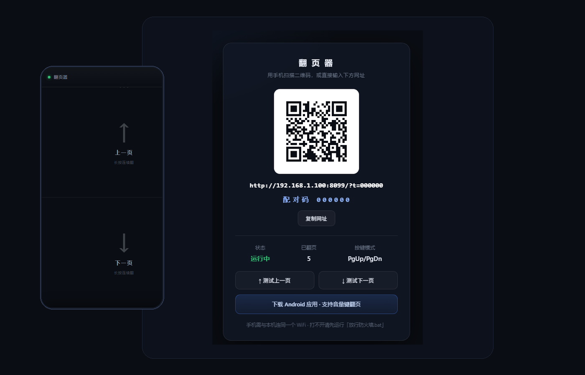

# 翻页器 · PageFlip

用手机控制电脑翻页。**音量上 = 上一页，音量下 = 下一页**。

局域网直连，不经过任何云端服务，断网（无外网）也能用。



> 截图中的地址与配对码为演示占位值，实际运行时由你的局域网 IP 与随机配对码决定。

---

## 快速开始

1. 双击 **`启动.bat`**（电脑需装 Python 3.8+）
2. 电脑浏览器打开终端里提示的 **`http://127.0.0.1:8000/desk`**
3. 手机扫屏幕上的二维码 —— 立刻就能点按翻页

> 电脑端按键模拟支持 Windows，需安装 Python 3.8+。手机和电脑需要处于可互相访问的同一局域网，通常连接同一个 WiFi 即可。端口被占用时，以终端显示的实际地址为准。

---

## 配对码

服务端首次启动会生成一个 **6 位配对码**，保存在项目根目录的 `.pairing` 文件里，重启后不变。

- 电脑控制台（`/desk`）会显示配对码，**二维码里已经带上它**
- 手机扫码后自动完成配对，**不需要手动输入**
- 只有在手动输入地址时，才需要再输一次配对码
- 配对码接口只回给 `127.0.0.1`，局域网内其他设备读不到

**UDP 与 HTTP 两个通道都校验配对码**：错误配对码不会执行按键，UDP 返回 `auth`，HTTP 返回 403；触发猜码限速时 HTTP 返回 429。
这可以防止同一网络里的其他设备向你的电脑乱发翻页、回车、Esc 等按键。

想更换配对码：删掉 `.pairing` 后重启服务即可。临时关闭校验用 `--no-auth`（**不推荐**，仅限完全可信的网络）。

### 手机 App：扫码填写

App 设置页点 **「扫 码 填 写」**，把电脑控制台上的二维码放进取景框，
**地址和配对码会一次读入并自动连接**，不用手打任何字符。

二维码内容形如 `http://<ip>:<port>/?t=<配对码>`，与 `/desk` 页面显示的完全一致。

扫码界面还有三个备选入口：

- **从相册选**：电脑上截个图，手机相册里选它，一样能识别
- **粘贴链接**：复制控制台显示的手机访问链接（含 `?t=` 配对码），在 App 中粘贴；不要复制 `127.0.0.1` 的电脑控制台地址
- **手电筒**：光线不足时打开，识别率会明显提升

> 扫码需要相机权限。没有摄像头或拒绝授权时会提示改用其它方式，不影响使用。

---

## 开始 / 停止遥控

遥控是一个有明确开始与结束的会话，而不是一直挂在后台。

**开始**：填好地址与配对码，点「连接」。这时才开始处理音量键、发送指令、拉起常驻服务。

**停止**：遥控页右上角「设置」→ **「停止遥控并退出」**。停止后会：

- 立即拒绝新指令、丢弃排队中的旧指令
- 关闭 UDP socket，释放全部唤醒锁
- 停掉后台常驻服务与通知
- 若已授权 `WRITE_SECURE_SETTINGS`，**直接关闭无障碍服务**
- 之后按音量键恢复正常调音量，不会再控制电脑

停止之后 App **不会**再把无障碍重新打开 —— 用户主动停止优先于任何自愈逻辑。

---

## 三种翻页方式

### 方式一：手机网页（免安装，iOS / Android 都能用）

扫码后打开的控制页：

- **上半屏点击** → 上一页
- **下半屏点击** → 下一页
- **长按** → 连续翻页
- 右上角 `···` → 开始放映 / 退出放映 / 黑屏 / 首页 / 末页

适合临时演示、不想装任何 App 的场景。

### 方式二：Android App（支持音量键，推荐）

1. 手机浏览器打开 `http://电脑IP:8000/`，或直接在电脑控制台点「下载 Android 应用」
2. 安装 `PageFlip.apk`（Android 6.0+，允许「未知来源」安装）
3. 打开 App，填入终端显示的地址（如 `192.168.1.100:8000`），点「连接」
4. **开启锁屏翻页**：点「开启锁屏翻页」→ 在系统列表里找到「翻页器」并打开
5. **关闭电池优化**：点设置页底部那行「电池优化未关闭」，把 App 加入白名单
6. 按音量上/下键翻页。锁屏遥控依赖无障碍服务与厂商后台策略，需在自己的手机上确认

遥控会话中，App 在能接收到按键时消费音量键并发送翻页指令。停止遥控后恢复正常音量键行为。

#### 锁屏翻页是怎么做到的

本 App 使用声明了 `FLAG_REQUEST_FILTER_KEY_EVENTS` 的**无障碍服务**，在系统允许时拦截后台或锁屏状态下的音量键。硬件、系统版本与厂商策略会影响按键派发，无法保证所有设备锁屏时都有效。

开启时 Android 会显示无障碍权限提示，具体文字因系统而异。
本 App 只处理音量键，不读取屏幕文字、不记录输入、不联网上传任何内容（代码全部在 `android/src/` 下可自查）。

**部分国产 ROM（小米 / 华为 / OPPO / vivo）的省电策略会在锁屏时不给无障碍服务派发按键。**
遇到这种情况，App 里的「音量键兼容模式」（默认开启）会接管：用 `ContentObserver` 直接监听
系统音量设置项，音量一变就翻页，并立刻把音量还原到原值，用户只会感觉到翻页。

> 兼容模式的盲区：音量已经到最大 / 最小时，同方向再按不会产生变化，也就感知不到。
> 所以能开无障碍就开无障碍，兼容模式只是兜底。

#### 一加 / OPPO / realme（ColorOS）排查设置

如果出现「前两三次能用，之后失灵」，可检查后台用电、自启动和进程冻结策略。菜单名称随系统版本变化，以下为常见入口：

1. **设置 → 电池 → 应用耗电管理 → 翻页器**
   打开「允许完全后台行为」「允许自启动」「允许关联启动」
2. **设置 → 应用 → 自启动管理 → 翻页器 → 开启**
3. **设置 → 电池 → 更多设置 → 睡眠待机优化 → 关闭**
4. **最近任务** → 翻页器卡片**下拉锁定**（卡片右上角出现小锁）
5. App 内点「电池优化未关闭」那行，加入白名单

App 自身已经启动了一个**前台常驻服务**（状态栏会有一条低优先级通知「音量键翻页已就绪」），
以提高后台存活机会。前台服务仍不能保证系统持续派发锁屏按键。

#### 可选：失联自愈

某些系统会在一段时间后偷偷关掉无障碍服务。授权后 App 可以自己把它重新打开：

```bash
adb shell pm grant com.pageflip.remote android.permission.WRITE_SECURE_SETTINGS
```

执行一次即可，之后常驻服务每 15 秒自检一次，发现服务被关就自动恢复。

### 方式三：iOS 快捷指令 + 轻点背面（真·物理手势）

iPhone 不支持第三方 App 监听音量键，但可以用系统级手势：

1. 「快捷指令」App → 新建快捷指令
2. 添加动作 **「获取 URL 内容」**
   - URL：`http://电脑IP:8000/next?t=你的6位配对码`
   - 方法：`GET`
3. 命名为「下一页」
4. 同样再做一条 `http://电脑IP:8000/prev?t=你的6位配对码`，命名「上一页」
5. 「设置 → 辅助功能 → 触控 → 轻点背面」
   - 轻点两下 → 下一页
   - 轻点三下 → 上一页

将 IP、端口和配对码替换为电脑控制台显示的实际值。更换配对码后也需要更新快捷指令。轻点背面是否可用取决于 iPhone 型号与系统设置。

---

## 关于音量键：为什么必须装 App

手机浏览器（iOS Safari、Android Chrome）**都收不到音量键事件** —— 音量键是系统独占的硬件按键，网页拿不到。

本项目通过原生 Android App 处理音量键，网页适合点按控制：

- 免费、开源、无广告、无账号
- 数据只在你自己的局域网里
- 通过键盘事件控制当前前台软件（PPT / PDF / 浏览器 / 图片查看器等），需确认目标软件支持所选快捷键

---

## 黑屏翻页

如果想降低演讲时手机屏幕的亮度，可以使用 App 的「熄屏」按钮。它实际是黑屏显示模式，屏幕仍保持唤醒。

遥控页右上角点 **「熄屏」**，界面会立刻变成全黑：屏幕保持唤醒，但显示纯黑、亮度压到最低。

**为什么这样做而不是真的熄屏：**

物理锁屏后的按键派发受机型和厂商策略影响。黑屏模式保持前台 Activity 和屏幕唤醒，通过当前界面接收按键。

**关于功耗的说明（重要）：**

OLED 屏幕的纯黑显示通常能降低显示功耗；LCD 屏幕仍需要背光。实际收益取决于设备：

- 屏幕只是整机功耗的一部分，CPU、Wi-Fi、内存仍然在工作；
- 黑屏模式可能降低显示功耗，**不等于整机接近物理熄屏**；
- 本项目**没有做过真机功耗测量**，因此不给瓦数结论。需要的话请用同一台手机、同一网络，
  分别测「普通界面 / 全黑界面 / 物理熄屏 / 结束遥控后待机」各 30–60 分钟的耗电对比。

这个模式的设计是：

- **减少静态显示**：以黑色覆盖遥控界面，降低长时间显示固定图案的影响，不作烧屏保证
- **保持前台**：屏幕保持唤醒，避免按键必须先唤醒设备
- **不依赖无障碍**：通过前台 Activity 接收音量键
- 状态栏、导航栏全部隐藏，WebView 暂停（停止渲染与状态轮询）

**怎么退出：** 点一下屏幕会浮现极暗的提示，**两秒内再点一次**退出。按返回键也能退出。
黑屏下按音量键会有一记 12ms 的轻微震动作为盲按确认。

> 当前默认不额外申请 CPU 唤醒锁和 Wi-Fi 低延迟锁，黑屏模式通过保持屏幕唤醒工作。

---

## 响应速度

App 优先走 **UDP 通道**，超时后回退到 HTTP。历史开发记录中的本机回环 UDP 往返约 **0.3–1 ms**；这不能代表真实 WiFi 下的延迟。

注意：这是**网络往返**，不等于「手指按下到电脑画面改变」的端到端时间。后者还包含
按键事件分发、`SendInput` 注入、目标软件重绘，本项目没有测过端到端时延。

App 侧做了什么：

- 复用 `DatagramSocket` 与已解析的 `InetAddress`，每个按键不重建连接
- 单线程串行发送保证顺序；队列上限 8 条、命令 1.5 秒过期，网络卡顿恢复后不会补翻一串旧页
- UDP 超时 150 ms 后用**同一个命令 ID** 走 HTTP 回退，服务端去重，不会翻两页

服务端对应优化：关闭 Nagle 合并、跳过启动时的反向 DNS 解析、去掉每个按键固定 20 ms 的等待。

> 锁屏时的网络调度与省电策略可能增加延迟；当前没有真机端到端时延与功耗测试结论。

---

## 命令行参数

```bash
python server.py                    # 默认：PageUp / PageDown
python server.py --mode arrow       # 方向键 ↑ / ↓（PDF、网页浏览更顺）
python server.py --mode space       # PageUp / 空格（PPT 常用）
python server.py --port 9000        # 指定端口
python server.py --dry-run          # 只打印不按键，用于调试
```

| 模式 | 上一页 | 下一页 | 适用 |
|---|---|---|---|
| `page`（默认） | PageUp | PageDown | PPT 放映、大多数阅读器 |
| `arrow` | ↑ | ↓ | 网页滚动、PDF 逐行 |
| `space` | PageUp | 空格 | PowerPoint 习惯键位 |

---

## 常见问题

**手机打不开网址**

- 先运行 **`放行防火墙.bat`**（需管理员），或首次启动时在防火墙弹窗点「允许」
- 检查手机和电脑是否在可互通的同一局域网（电脑 `ipconfig` 看 IPv4，使用控制台显示的手机访问地址）
- **校园网 / 公司网 / 酒店 WiFi 常开「AP 隔离」**，设备之间互相访问不了。换手机热点：电脑连手机热点，或手机连电脑热点

**翻页没反应，但服务端有记录**

- 按键发给了**当前前台窗口**。确保 PPT/PDF 是活动窗口，不要在翻页时点到别的程序
- 如果目标程序以管理员身份运行，`server.py` 也需要管理员权限（UIPI 限制）

**音量键没反应（App）**

- 先在 App 前台或黑屏模式测试。后台或锁屏需要开启「锁屏翻页」及系统无障碍服务
- 若前台有效、锁屏无效，检查后台限制与电池优化；部分机型仍可能不派发锁屏按键
- 使用结束后点「停止遥控并退出」，恢复系统音量键行为

**二维码扫不出来**

- 二维码是本地生成的，不需要外网。扫不出就手动输入地址，输入一次后浏览器会记住

**端口被占用**

- 会从指定端口向后寻找 20 个端口（默认 8000-8019），以终端打印的地址为准

---

## 目录结构

```
PageFlip/
├── server.py              电脑端服务（零第三方依赖）
├── qr.py                  本地二维码生成器
├── web/
│   ├── index.html         手机控制页
│   └── desk.html          电脑控制台（二维码 / 状态 / 测试）
├── android/
│   ├── PageFlip.apk       ← 编译好的安装包
│   ├── AndroidManifest.xml
│   ├── src/…/MainActivity.java
│   ├── src/…/ScanActivity.java      扫码界面（相机预览 + ZXing 解码）
│   ├── src/…/Dispatcher.java        指令分发（UDP 优先 / 幂等 / 会话代次）
│   ├── src/…/VolumeKeyService.java  无障碍服务（锁屏音量键）
│   ├── src/…/KeepAliveService.java  前台常驻服务
│   ├── libs/core-3.5.3.jar          ZXing core（二维码解码，纯 Java）
│   ├── libs/LICENSE-ZXing.txt       Apache-2.0 完整许可证
│   ├── libs/NOTICE-ZXing.txt        上游署名声明
│   ├── res/mipmap-*/      图标
│   ├── make_icon.py       图标生成
│   └── build_apk.py       一键编译 APK（不需要 Gradle）
├── 启动.bat
├── 放行防火墙.bat
├── tests/                 服务端回归测试
├── LICENSE
└── README.md
```

## 第三方组件

| 组件 | 用途 | 许可证 |
|---|---|---|
| [ZXing core 3.5.3](https://github.com/zxing/zxing) | Android 端二维码解码（`android/libs/core-3.5.3.jar`） | Apache-2.0（见 `android/libs/LICENSE-ZXing.txt`） |

电脑端使用 Python 标准库，手机网页使用浏览器原生 API，不需要安装第三方包。Android APK 会附带 ZXing 的许可证和署名声明。

当前 jar 已核对 Maven Central 的 [SHA-1 摘要](https://repo.maven.apache.org/maven2/com/google/zxing/core/3.5.3/core-3.5.3.jar.sha1)：`ca1349214a356cd7958651b2d5a0e1f3811a9c4b`。

## 重新编译 APK

当前构建脚本面向 **Windows**，不需要 Gradle 或 Android Studio。需要 Python 3.8+、JDK 17+（`javac`、`keytool` 在 PATH 中），以及 Android SDK 的 `build-tools`（建议 35+）和 `android-34` 或更高平台。App 的最低系统版本为 Android 6.0（API 23）。

```powershell
cd android
python make_icon.py     # 重新生成图标（可选）
python build_apk.py     # 输出 PageFlip.apk
```

`build_apk.py` 会自动在 `ANDROID_SDK_ROOT` / `ANDROID_HOME` / 常见安装路径里找 SDK，
并挑选版本号最高的可用 `build-tools` 和 `android-XX`。产出约 300 KB。

### 发布签名

默认在本机生成 `android/debug.keystore`（口令 `android`，已被 Git 忽略），仅适合自用和分发测试包。仓库附带的 APK 也是测试签名包。
要出正式签名包，用环境变量指定自己的密钥：

```powershell
$env:PF_KEYSTORE = "C:\keys\release.jks"
$env:PF_KEYSTORE_PASS = "你的密钥库口令"
$env:PF_KEY_ALIAS = "pageflip"
$env:PF_KEY_PASS = "你的密钥口令"
python build_apk.py
```

密钥文件与口令不要提交到仓库。请妥善保存自己的签名密钥；重新生成 debug 密钥后，签名不同的 APK 无法直接覆盖已安装版本，需要卸载旧版再安装。

---

## 安全说明

- 服务端绑定 `0.0.0.0`，监听所有 IPv4 网络接口；可访问范围取决于路由与防火墙。请在可信局域网使用，不要映射到公网。服务端不主动访问外部服务，没有遥测、没有账号体系。
- 执行按键的请求必须带 6 位配对码（`.pairing` 文件首次启动随机生成，重启不变）；静态页面、APK 和状态接口可在网络内访问。
  配对码接口 `/api/pair` 只回给 `127.0.0.1`，局域网内其他设备读不到。
- 猜码限速：同一 IP 60 秒内错 10 次即锁定。
- HTTP 与 UDP 通道没有加密；配对码不能抵御能监听或控制该网络的攻击者。
- App 只处理音量键，不读取屏幕文字、不记录输入、不联网上传任何内容。
- 但要注意：**配对码等同于遥控权限**。首次启动后请确认 `.pairing` 里的 6 位数字
  没有被截图或拍照外传；怀疑泄露就删掉 `.pairing` 重启服务，会重新生成。

> 本项目在 Windows 上开发与验证（`SendInput` 注入按键）。
> 服务端代码在非 Windows 平台也能启动，但会提示不支持按键模拟。

---

## 验证与已知限制

历史开发记录（2026-10-22，Android 15 / Pixel 8 Pro 模拟器）覆盖了 APK 安装、前台音量键、黑屏界面、无障碍服务连接和前台服务启动。模拟器结果不能证明真机锁屏兼容性。

- 尚未验证真机耗电、温升，以及 ColorOS 等系统上的锁屏按键与省电兼容性。
- 模拟器注入的按键不能替代真实物理音量键；请在演示前用自己的手机测试前台、黑屏、锁屏和停止遥控。
- Windows 按键注入只作用于当前前台窗口，是否翻页取决于目标程序的快捷键和权限。服务端接受命令不等于目标程序已改变画面。
- 服务端不支持 macOS / Linux 的真实按键模拟，可使用 `--dry-run` 调试网络协议。

在项目根目录运行服务端回归测试：

```powershell
python -m unittest discover -s tests -v
```

测试使用模拟执行模式，不注入真实键盘事件。手工检查时也可用 `python server.py --dry-run` 启动服务，确认配对、扫码和命令记录。

Android 构建脚本的签名、许可和控制台编码回归测试：

```powershell
python -m unittest discover -s android -p test_build_apk.py -v
```

使用 JDK 18+ 还可运行 `python android/check_dispatcher_cancel.py`：它会阻塞 DNS 解析、停止会话后再恢复解析，检查旧指令不会发出，且新会话可以正常发送。此测试使用本机 UDP 与最小 Android API 替身，不代表真机兼容性测试。

## 参与开发

欢迎提交 Issue 或 Pull Request。报告问题时请注明 Windows / Android 版本、手机型号、复现步骤，以及问题发生在前台、黑屏还是锁屏。截图与日志请遮住配对码。

修改后运行上述回归测试；涉及 Android 时重新构建 APK，并说明实际测试过的设备与场景。

本项目代码采用 [MIT License](LICENSE)；第三方 ZXing 组件保留其 Apache-2.0 许可证与上游署名声明。
